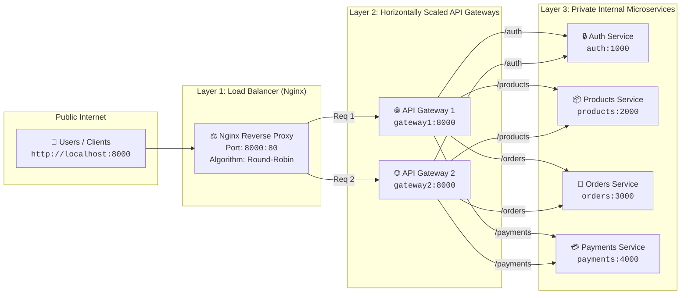

# Phase 02: System Design Architecture

Comprehensive guide to Microservices, API Gateway, Load Balancing, and Horizontal Scaling.

---

## 🏛️ System Architecture Diagram



---

## 🪜 Step-by-Step Architecture Breakdown

### Step 1: Microservices (The Workers)
* **What it is:** Instead of one massive server containing all code, we split features into **single-responsibility services**:
  * `auth:1000`: Only handles users & authentication.
  * `products:2000`: Only handles product catalog.
  * `orders:3000`: Only handles order creation & history.
  * `payments:4000`: Only handles transactions.
* **Why:** If the `payments` service has a bug or high load, it won't crash `auth` or `products`. Teams can deploy services independently.
* **Key Principle:** Microservices are **private**. They do not expose ports to the outside internet.

### Step 2: API Gateway (The Single Front Door)
* **What it is:** A specialized reverse proxy that acts as the entry point for all clients.
* **Why:** Without an API Gateway, the frontend app would need to know 4 different IP addresses and ports. With a Gateway, the frontend only talks to `http://localhost:8000`.
* **Path-Based Routing:**
  * `GET /auth` ➔ forwards to `http://auth:1000`
  * `GET /products` ➔ forwards to `http://products:2000`
  * `GET /orders` ➔ forwards to `http://orders:3000`
  * `GET /payments` ➔ forwards to `http://payments:4000`

### Step 3: Load Balancing (Traffic Distribution)
* **What it is:** An Nginx instance placed in front of our API Gateways.
* **Why:** If 100,000 users hit a single API Gateway, that gateway becomes a **Single Point of Failure (SPOF)** and a bottleneck.
* **Round-Robin Algorithm:** Nginx sends:
  * Request 1 ➔ `gateway1`
  * Request 2 ➔ `gateway2`
  * Request 3 ➔ `gateway1` ...

### Step 4: Horizontal Scaling & High Availability
* **Horizontal Scaling:** Adding *more instances* of a server (e.g. `gateway1`, `gateway2`, `gateway3`) instead of buying a bigger machine (Vertical Scaling).
* **High Availability (HA):** If `gateway1` crashes, Nginx immediately routes all traffic to `gateway2` with **zero downtime**.
* **Docker Optimization:** Both `gateway1` and `gateway2` share the exact same Docker image (`api-gateway:latest`), saving disk space and memory.

---

## ⚡ Under-the-Hood: Request Life Cycle

```
1. Client sends GET http://localhost:8000/products
2. Docker port mapping forwards port 8000 to Nginx port 80.
3. Nginx upstream picks Gateway 1 (Round-Robin).
4. Gateway 1 receives GET /products.
5. express-http-proxy looks up internal DNS for "products:2000".
6. Docker internal DNS resolves "products" to Container IP (e.g., 172.20.0.4).
7. Products service responds with JSON: {"service":"📦 Products Service"}.
8. Gateway 1 forwards JSON response back to Nginx.
9. Nginx forwards JSON response back to Client.
```
